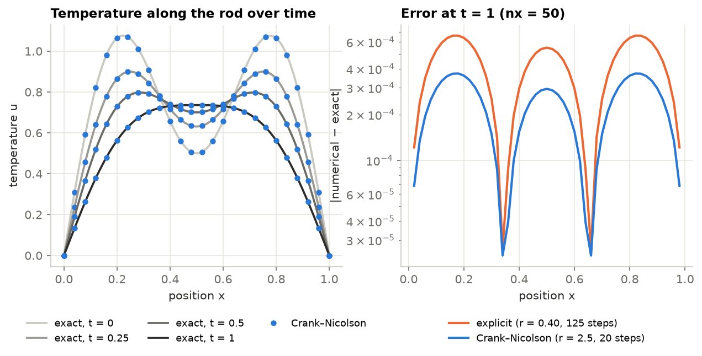
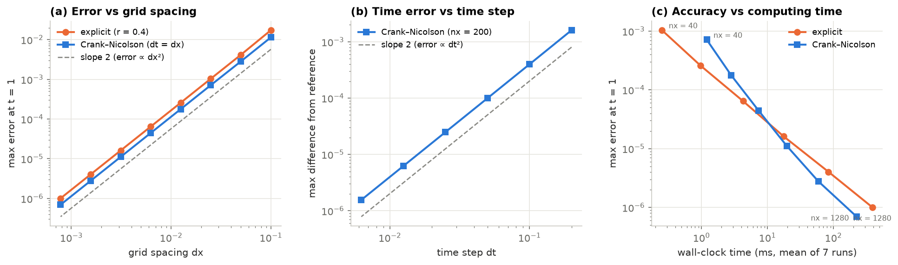
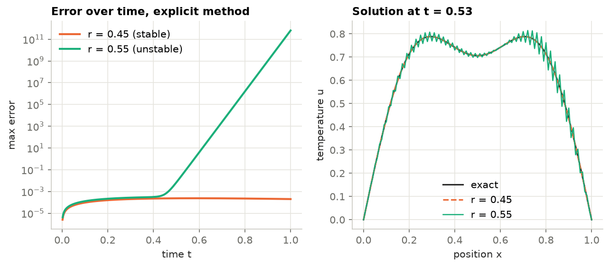
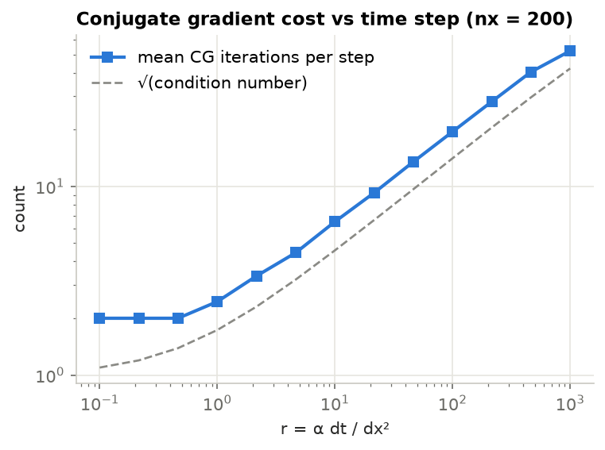

# Heat equation: classical numerics vs physics-informed neural networks

Solving the 1D heat equation with finite-difference methods in NumPy and (next) a physics-informed neural network, and checking every method against the exact solution.

**Status:** Part 1 (classical solvers) is done. Parts 2 and 3 are in progress, see the [roadmap](#roadmap).

## Why I'm building this

I come from backend engineering and I'm learning how scientific computing handles partial differential equations. I started with the heat equation because it has an exact solution, so each method can be measured against the true answer instead of judged by eye. The plan is to solve the same problem in two very different ways, with classical numerical methods and with a physics-informed neural network, and compare them on accuracy, cost, and how well they recover unknown parameters from noisy data.

## The problem

Heat spreading along a rod of length 1 whose ends are held at zero temperature:

$$
\frac{\partial u}{\partial t} = \alpha \frac{\partial^2 u}{\partial x^2}, \qquad 0 < x < 1, \quad 0 < t \le 1,
$$

$$
u(0,t) = u(1,t) = 0, \qquad u(x,0) = \sin(\pi x) + 0.5\,\sin(3\pi x), \qquad \alpha = 0.02 .
$$

Each sine wave in the starting temperature keeps its shape and decays at its own rate, which gives the exact solution

$$
u(x,t) = e^{-\alpha \pi^2 t}\sin(\pi x) + 0.5\, e^{-9\alpha \pi^2 t}\sin(3\pi x).
$$

The sharper wave decays nine times faster, so the two bumps in the starting temperature gradually merge into one (left panel of the first figure below).

## Methods

Both solvers split the rod into `nx` intervals of width $\Delta x$ and replace $u_{xx}$ with the standard second difference $(u_{i+1} - 2u_i + u_{i-1}) / \Delta x^2$. They differ in how they step forward in time. The key number is

$$
r = \frac{\alpha\, \Delta t}{\Delta x^2}.
$$

**Explicit (forward Euler).** $u_i^{n+1} = u_i^n + r\,(u_{i+1}^n - 2u_i^n + u_{i-1}^n)$. Each step is one vectorised NumPy operation, but it is only stable when $r \le 1/2$, so $\Delta t$ has to shrink like $\Delta x^2$ as the grid is refined.

**Crank–Nicolson.** Averages the old and new time levels: $(I - \tfrac{r}{2}A)\,u^{n+1} = (I + \tfrac{r}{2}A)\,u^n$, where $A$ is the tridiagonal second-difference matrix. It is stable for any time step and second-order accurate in time, but each step needs a linear solve.

**Linear solver.** I wrote conjugate gradient (CG) in NumPy. It never builds the matrix, only applies it to a vector, and it starts each solve from the previous time step. The tests check it against a direct tridiagonal solver (Thomas algorithm) and `numpy.linalg.solve`. In 1D a direct tridiagonal solve would actually be the cheapest option. I used CG because it is what scales to 2D and 3D problems, and because it let me look at how the time step affects the conditioning of the system (result 5).

## Results

All numbers below come from `experiments/` and are saved in [`results/`](results). Timings depend on the machine.

### 1. Both methods match the exact solution



With `nx = 50`, the explicit method (r = 0.40, 125 steps) has a maximum error of 6.6 × 10⁻⁴ at t = 1. Crank–Nicolson with a time step about six times larger (r = 2.5, 20 steps) has 3.7 × 10⁻⁴.

### 2. Both are second-order accurate, as theory predicts



**(a)** Halving $\Delta x$ cuts the error by 4 for both methods, so the observed order is 2 (between 1.99 and 2.06 at every refinement level). The explicit method uses r = 0.4, and Crank–Nicolson uses $\Delta t = \Delta x$. **(b)** To isolate the time error, I fixed a fine grid (`nx = 200`) and compared Crank–Nicolson against a reference run with $\Delta t = 10^{-4}$. Halving $\Delta t$ cuts the error by 4 again, so the observed order in time is 2.00.

Matching the theoretical slope is a much stronger check than a plot that "looks right", because most bugs show up as the wrong slope.

### 3. Which method is faster depends on the grid size

| nx | explicit steps | explicit error | explicit time (ms) | CN steps | CN error | CN time (ms) | mean CG iterations |
|---:|---:|---:|---:|---:|---:|---:|---:|
| 40 | 80 | 1.04e-03 | 0.2 ± 0.0 | 40 | 7.14e-04 | 1.0 ± 0.0 | 2.3 |
| 80 | 320 | 2.58e-04 | 0.8 ± 0.0 | 80 | 1.78e-04 | 2.7 ± 1.0 | 3.0 |
| 160 | 1280 | 6.45e-05 | 3.2 ± 0.1 | 160 | 4.45e-05 | 6.2 ± 0.3 | 4.0 |
| 320 | 5120 | 1.61e-05 | 13.9 ± 1.2 | 320 | 1.11e-05 | 16.3 ± 0.4 | 5.5 |
| 640 | 20480 | 4.03e-06 | 61.5 ± 1.3 | 640 | 2.78e-06 | 51.3 ± 4.3 | 7.6 |
| 1280 | 81920 | 1.01e-06 | 322.8 ± 24.3 | 1280 | 6.96e-07 | 164.2 ± 10.3 | 10.7 |

Times are the mean ± standard deviation of 7 runs. Because the explicit method needs $\Delta t \propto \Delta x^2$, its number of steps grows like `nx²`, while Crank–Nicolson's grows like `nx`. On small grids the explicit method still wins: each step is a single NumPy operation, while each Crank–Nicolson step runs a few CG iterations with Python overhead. The two lines in panel (c) of the figure above cross between `nx = 320` and `nx = 640`. At `nx = 1280` Crank–Nicolson was about twice as fast for a slightly smaller error. Counting operations alone would not have predicted where the crossover falls.

### 4. The explicit method's stability limit is real



For the explicit method, the most jagged wave the grid can hold (values alternating up and down from point to point) is multiplied by roughly $G = 1 - 4r$ every step. At r = 0.45 that factor is 0.80 in size, so it dies out. At r = 0.55 it is 1.20, so it grows by about 20% per step. It starts at round-off level (about 10⁻¹⁶) and stays hidden below the normal discretisation error until around t ≈ 0.4, then takes over and reaches 10¹² by t = 1. The right panel shows the zigzag just as it becomes visible.

### 5. Bigger time steps make each Crank–Nicolson step harder



The condition number of $I - \tfrac{r}{2}A$ is about $1 + 2r$, and CG theory says iterations grow roughly like its square root. The measured iteration counts follow that trend: 2 per step for r ≤ 0.5, about 20 at r = 100 and 53 at r = 1000 (condition number ≈ 1781). So "unconditionally stable" does not make large time steps free. The cost moves from the number of steps into the linear solver. A preconditioner would reduce this, and it is on the roadmap.

## Roadmap

- [x] **Part 1:** explicit and Crank–Nicolson finite-difference solvers, CG in NumPy, convergence, stability and conditioning studies
- [ ] **Part 2:** physics-informed neural network (PyTorch) for the same problem, compared with Part 1 on accuracy and cost
- [ ] **Part 3:** inverse problem: estimate α from noisy temperature measurements, with uncertainty over repeated noise draws
- [ ] Preconditioned CG and a 2D version of the problem

## Running it

```bash
git clone https://github.com/mansi75/heat-equation-numerics-vs-pinn.git
cd heat-equation-numerics-vs-pinn
python -m venv .venv && source .venv/bin/activate
pip install -r requirements.txt
pip install -e .

pytest                          # 9 correctness checks
python experiments/run_all.py   # regenerates every figure and results table
```

Part 1 uses only NumPy, plus Matplotlib for the plots.

## Repository layout

```
src/heat1d/
  problem.py      the equation, starting temperature and exact solution
  solvers.py      explicit and Crank–Nicolson solvers
  linalg.py       conjugate gradient and tridiagonal (Thomas) solver
experiments/      one script per figure, plus run_all.py
figures/          generated plots
results/          generated tables
tests/            correctness checks (exact solution, solvers, convergence order)
```

## References

- R. J. LeVeque, *Finite Difference Methods for Ordinary and Partial Differential Equations*, SIAM, 2007.
- J. R. Shewchuk, *An Introduction to the Conjugate Gradient Method Without the Agonizing Pain*, 1994.
- L. A. Barba and G. F. Forsyth, "CFD Python: the 12 steps to Navier–Stokes equations", *Journal of Open Source Education*, 2018.
- M. Raissi, P. Perdikaris and G. E. Karniadakis, "Physics-informed neural networks: A deep learning framework for solving forward and inverse problems involving nonlinear partial differential equations", *Journal of Computational Physics* 378, 2019.
